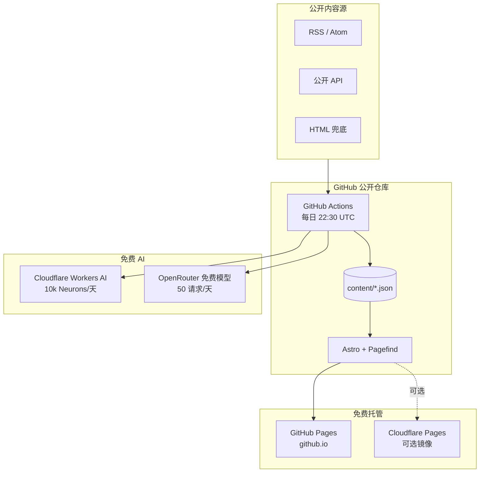
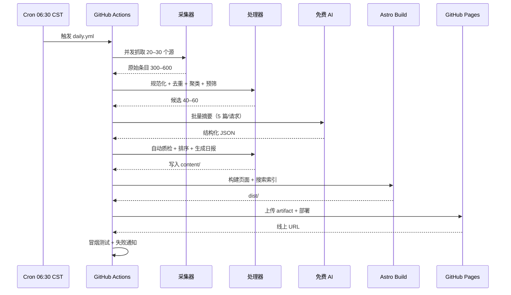

# Signal Daily（信号日报）
## 科技 · 金融 · AI 每日资讯站 — 项目企划书 v1.2

| 项目 | 内容 |
|------|------|
| 文档版本 | v1.2（个人使用 / 中国大陆 / 零成本 / 全自动） |
| 日期 | 2026-11-06 |
| 状态 | Draft（仅企划书，本次不开发） |
| 使用者 | 仅作者本人（personal use） |
| 工作名 | Signal Daily（名称随意，不购买域名） |
| GitHub | `178124151/news-for-days`（公开仓库） |
| 访问地址 | `https://178124151.github.io/news-for-days/` |
| 托管 | GitHub Pages 主；Cloudflare Pages 可选免费镜像 |
| 本次交付 | 仅项目企划书；不写代码、不建仓库、不部署 |
| 内容 | 科技 / 金融 / AI，每日 20–30 条 |
| 更新方式 | GitHub Actions 每日 06:30（CST）自动采集、摘要、构建、发布 |
| 编辑方式 | 全自动，无人工编辑；自动质检 + AI 标识 |
| 月度现金成本 | **$0** |

---

## 0. 一页摘要

**做什么：** 一个只给自己用的科技、金融、AI 每日资讯站。GitHub Actions 每天清晨从 20–30 个公开源抓取内容，去重、聚类、用免费 AI 生成中文摘要，构建成静态页面后自动发布到 GitHub Pages。不买域名、不买服务器、不买 API、不做人工编辑。

**为什么：** 你不需要一个媒体产品，只需要一个每天 5–10 分钟就能看完的信息过滤器。公开信息源足够多，免费工具链足够成熟，缺的只是把它们串起来。

**怎么做：**

```
GitHub 公开仓库
  ├── GitHub Actions：每天 22:30 UTC（06:30 CST）定时运行
  ├── TypeScript 管线：采集 → 去重 → 聚类 → 免费 AI 摘要 → 自动质检
  ├── Astro：构建静态页面 + Pagefind 搜索索引 + RSS
  └── GitHub Pages：发布到 https://178124151.github.io/news-for-days/
```

**AI 用哪个：**

- 主：Cloudflare Workers AI 免费额度，10,000 Neurons/天，Qwen3-30B 级别模型；
- 备：OpenRouter 免费模型，50 请求/天、20 RPM，批量 5 篇/请求；
- 兜底：抽取式摘要 + 原文标题，页面标注「中文摘要暂不可用」。

**成本：** 全链路 $0/月。唯一需要额外付出的是 30–45 小时开发时间。

**必须先接受的一个硬真相：**

> GitHub Pages 和 Cloudflare Pages 在中国大陆都**不保证稳定直连**。零成本、大陆稳定访问、静态托管，这三者无法同时满足。本方案选择「零成本 + 可接受的访问不稳定」，并提供三个免费兜底：代理访问、Cloudflare Pages 镜像、本地构建。每日邮件本次不纳入 MVP（后续可选）。若要求大陆稳定直连，只能走国内对象存储 + CDN + ICP 备案，约 ¥10–50/月起。

---

## 1. 背景与个人需求

### 1.1 为什么做这个

- 科技、金融、AI 三个领域正在交叉，重要信息分散在英文媒体、实验室博客、监管文件和中文垂直媒体里；
- 每天真正值得知道的内容只有 20–30 条，但你需要翻 20–30 个站点；
- 现有聚合产品要么面向大众、广告和点击率优先，要么只覆盖单一领域；
- 你只需要一个「每天早上看一眼」的私人信息入口，不需要评论、账号、推荐算法和商业化。

### 1.2 个人使用场景

| 场景 | 时间 | 行为 |
|------|------|------|
| 早间速览 | 07:00–07:10 | 打开首页，看 5–8 条头条和分类速览 |
| 通勤补课 | 路上 | 点开 3–5 条感兴趣的原文 |
| 按主题回看 | 周末 | 进 AI / 科技 / 金融分类，或搜索某个公司 |
| 历史检索 | 需要时 | 搜「英伟达」「美联储」「OpenAI」，看历史条目 |

### 1.3 不做什么

- 不做公开媒体、不追求 UV、不做增长；
- 不做账号、评论、UGC、社区；
- 不做实时行情、交易信号、投资建议；
- 不做全文转载、不镜像图片、不绕过付费墙；
- 不接广告、不做会员、不商业化；
- 不做人工每日编辑。

---

## 2. 产品定义

### 2.1 一句话

> **每天早上 5–10 分钟，读完科技、金融、AI 里真正值得知道的 20–30 件事。**

### 2.2 内容边界

| 做 | 不做 |
|----|------|
| 科技公司动态、产品发布、开源项目 | 全文转载、镜像源站 |
| AI 模型、论文、产业应用、算力 | 未经验证的传闻、截图 |
| 金融政策、融资并购、市场监管 | 实时行情、K 线、个股推荐 |
| 科技与金融交叉事件 | 个人隐私、内幕信息 |
| 每日精选、分类流、历史存档 | UGC、评论、投稿 |

### 2.3 栏目

| 栏目 | 内容 | 每日条数 |
|------|------|---------|
| 今日头条 | 当日最重要的跨领域事件 | 5–8 |
| AI | 模型、论文、产品、算力、监管 | 8–12 |
| 科技 | 大厂、创业、开源、硬件 | 8–12 |
| 金融 | 政策、融资、市场结构、金融科技 | 6–10 |
| 政策 | 中美欧监管、标准、出口管制 | 0–4 |

### 2.4 单条内容标准

- 中文标题 ≤ 30 字，保留英文原标题；
- 摘要 80–200 字，只陈述事实；
- 3 条要点，每条 ≤ 40 字；
- 必填：来源、原文链接、发布时间、抓取时间、分类、标签；
- 标注「AI 摘要 · 自动生成，可能有误」；
- 同一事件只保留一张主卡，其余来源折叠。

---

## 3. 功能范围

### 3.1 MVP（3 周）

| 模块 | 功能 | 优先级 |
|------|------|--------|
| 采集 | RSS/Atom 为主，20 个源，超时与重试 | P0 |
| 处理 | URL/标题去重、同事件聚类、分类 | P0 |
| AI | 免费中文摘要、要点、标签、评分 | P0 |
| 质检 | Schema、中文占比、长度、禁用词、数字一致性 | P0 |
| 内容 | 日报、分类流、详情、来源页 | P0 |
| 检索 | Pagefind 站内搜索 | P1 |
| 订阅 | RSS/Atom | P0 |
| 发布 | GitHub Actions + GitHub Pages | P0 |
| 合规 | 关于、免责声明、隐私、下架流程 | P0 |
| 体验 | 响应式、暗色模式、阅读时长 | P1 |

### 3.2 V1.1（可选，1 周）

- 源从 20 扩到 30；
- Cloudflare Pages 免费镜像；
- 每日邮件摘要（本次不做，后续可选）；
- 标签页、来源页、周度回顾；
- 归档策略：超过 12 个月的内容降级为月度索引。

### 3.3 明确不做

评论、账号、实时行情、原生 App、付费墙绕过、自动发社交平台、广告、付费会员。

---

## 4. 零成本技术方案

### 4.1 总体架构



**四条原则：**

1. **仓库即数据库**：内容 JSON 与代码同仓，天然版本化、可回滚、可 diff。
2. **构建时计算**：所有摘要、排序、索引在 CI 完成，线上只有静态文件。
3. **无状态**：没有数据库、没有常驻服务，故障面最小。
4. **免费优先**：每个环节都选有免费额度且不需要绑卡的方案。

### 4.2 技术选型

| 层 | 选型 | 理由 |
|----|------|------|
| 框架 | Astro 5 | 内容站首选，默认零 JS，Content Collections 自带 schema |
| 语言 | TypeScript（strict） | 管线与模板共享类型 |
| 样式 | Tailwind CSS 4 | 快速、体积小 |
| 校验 | Zod | 构建前拦截脏数据 |
| 搜索 | Pagefind | 纯静态索引，无需服务端 |
| RSS 解析 | rss-parser / fast-xml-parser | 成熟、容错好 |
| AI 主 | Cloudflare Workers AI | 免费 10k Neurons/天，Qwen 中文可用 |
| AI 备 | OpenRouter 免费模型 | 免费额度足够批量摘要 |
| 调度 | GitHub Actions cron | 公开仓库免费 |
| 托管 | GitHub Pages | 免费、github.io、零配置 |
| 分析 | 不接入 | 个人使用，省掉隐私与脚本 |
| 包管理 | pnpm | 快、锁文件稳定 |
| 测试 | Vitest + Playwright 冒烟 | 覆盖去重与关键页面 |

**为什么不用 Next.js / 数据库 / CMS：**

- 内容每天只变一次，不需要 SSR；
- 静态站没有运行时漏洞面；
- 数据库会引入备份、迁移、连接数等长期负担；
- Git 已经提供审核、回滚、审计。

### 4.3 数据模型

```ts
// content/sources.json
interface Source {
  id: string;                 // techcrunch
  name: string;               // TechCrunch
  type: "rss" | "api" | "html";
  url: string;
  category: "ai" | "tech" | "finance" | "policy";
  lang: "en" | "zh";
  weight: number;             // 0–1，源权威度
  enabled: boolean;
}

// data/raw/2026-11-06/*.json（保留 7 天）
interface RawItem {
  sourceId: string;
  url: string;
  title: string;
  author?: string;
  publishedAt: string;        // ISO 8601
  fetchedAt: string;
  contentText: string;        // 仅用于加工，不入发布库
  lang: string;
}

// content/articles/2026/11/{id}.json
interface Article {
  id: string;                 // canonical URL 的 sha256 前 16 位
  slug: string;
  titleZh: string;
  titleOriginal: string;
  summary: string;            // 80–200 字
  keyPoints: string[];        // 3 条
  category: "ai" | "tech" | "finance" | "policy";
  tags: string[];             // 5 个
  entities: string[];         // 公司/机构/模型
  sourceId: string;
  sourceName: string;
  sourceUrl: string;
  publishedAt: string;
  fetchedAt: string;
  importance: number;         // 0–100
  clusterId?: string;
  alsoCoveredBy?: string[];
  readMinutes: number;
  aiProvider: "cloudflare" | "openrouter" | "extractive";
  aiModel: string;
  contentHash: string;
  status: "published" | "hidden";
}

// content/digests/2026-11-06.json
interface Digest {
  date: string;
  headlineIds: string[];
  sections: Record<string, string[]>;
  stats: {
    fetched: number;
    published: number;
    sources: number;
    aiFallbacks: number;
  };
}
```

**去重规则（按顺序）：**

1. canonical URL 完全一致 → 丢弃；
2. URL 归一化后一致（去 `utm_*`、`ref`、尾斜杠、`http/https`）→ 丢弃；
3. 标题归一化 + SimHash 汉明距离 ≤ 3 → 合并；
4. 同事件聚类：24 小时窗口内，实体重合 ≥ 2 且标题相似度 ≥ 0.6 → 同一 `clusterId`；
5. 聚类只影响展示，不删除文章记录。

### 4.4 每日流水线



**时间预算：**

| 阶段 | 耗时 |
|------|------|
| 采集（20–30 源，并发 6） | 2–4 min |
| 规范化 + 去重 | < 1 min |
| AI 摘要（20–30 篇，批量） | 2–5 min |
| 构建（1 万页以内） | 1–3 min |
| Pages 部署 | 1–3 min |
| **合计** | **< 15 min** |

### 4.5 免费 AI 方案（重点）

> ⚠️ **GitHub Models 已于 2026-07-30 完全退役**，不能再作为免费摘要方案。网上仍有很多教程在用它，注意甄别。

#### 可用方案对比

| 方案 | 免费额度 | 中文质量 | 接入 | 角色 |
|------|---------|---------|------|------|
| **Cloudflare Workers AI** | 10,000 Neurons/天 | 好（Qwen3 / Gemma 3） | Cloudflare API Token | **主** |
| **OpenRouter 免费模型** | 50 请求/天、20 RPM（未充值）；1,000/天（累计充值 ≥ $10） | 好（Qwen / Llama 系） | API Key | **备** |
| Google Gemini 免费层 | 以官网为准，限额会变 | 好 | API Key | 可选 |
| Groq 免费层 | 以官网为准 | 中 | API Key | 可选 |
| 本地 OPUS-MT / transformers.js | 无限制，耗 CPU | 中 | 无 | 最后兜底 |
| GitHub Models | **已退役** | — | — | 不可用 |

#### 主方案：Cloudflare Workers AI 的额度够不够？

以 25 篇/天、每篇输入 2,000 tokens、输出 500 tokens 计算：

| 模型 | 输入 Neurons | 输出 Neurons | 合计/天 | 占 10k 免费额度 |
|------|-------------|-------------|---------|----------------|
| `@cf/qwen/qwen3-30b-a3b-fp8` | ~231 | ~381 | ~612 | **6%** |
| `@cf/google/gemma-3-12b-it` | ~1,569 | ~632 | ~2,201 | 22% |
| `@cf/qwen/qwen3.8-27b` | ~2,045 | ~3,636 | ~5,681 | 57% |
| `@cf/meta/llama-3.1-8b-instruct-fp8-fast` | ~206 | ~436 | ~642 | 6% |

> 结论：**每天 20–30 篇完全放得下**。中文优先选 Qwen3-30B 或 Qwen3.8-27B；额度紧张时切 Llama 3.1 8B。免费额度每天 00:00 UTC 重置，以 Cloudflare 官网为准。

#### 备方案：OpenRouter 免费模型

- 未充值：20 请求/分钟、50 请求/天；
- 批量 5 篇/请求 → 50 × 5 = **250 篇/天**，足够；
- 免费模型列表会变，实施时用 `/api/v1/models` 过滤 `:free`，优先 Qwen / Llama 系；
- 失败自动切换下一个免费模型，不阻塞发布。

#### 调用策略

```ts
const chain = [
  cloudflareWorkersAI,   // 主
  openrouterFree,        // 备
  extractiveFallback,    // 兜底
];
```

- 按内容 `contentHash` 缓存，重复内容不重复调用；
- 批量 3–5 篇/请求，降低请求数；
- 单次超时 60s，失败重试 1 次，再切下一个 Provider；
- 全部失败 → 抽取式摘要 + 原文标题，页面标注「中文摘要暂不可用」；
- 单日免费额度使用率 > 80% → 自动切更便宜的模型或减少发布量。

### 4.6 自动质检（替代人工编辑）

> 没有人工编辑，就必须把「编辑的判断」变成可执行的规则。

| 检查 | 规则 | 不通过时 |
|------|------|---------|
| JSON Schema | Zod 严格校验 | 重试 1 次 → 降级 |
| 中文占比 | 摘要中 CJK 字符 ≥ 50% | 降级为抽取式 |
| 长度 | 80–200 字 | 截断或重写 |
| 禁用词 | 投资建议、必将、暴涨、独家、重磅等 | 删除/降级 |
| 数字一致性 | 摘要中的数字应能在原文找到 | 降级为抽取式 |
| 来源链接 | 非空、可访问 | 隐藏该条 |
| 重复 | 同 cluster 只留主卡 | 合并 |
| 低置信度 | importance < 40 | 不进头条，保留在分类流 |
| 敏感内容 | 个人隐私、内幕、未验证传闻 | 隐藏 |

**发布策略：**

- 通过质检 → 自动发布；
- 未通过 → 降级为抽取式摘要；仍不通过 → 隐藏；
- 每日 `data/health/YYYY-MM-DD.json` 记录：抓取数、发布数、AI 降级数、失败源、耗时；
- 页面固定标注「AI 摘要 · 自动生成，可能有误」；
- 不做人工审核，接受偶发错误；发现明显问题可通过 GitHub Issue 下架。

### 4.7 站点与 SEO

**信息架构：**

```
/                       首页：今日头条 + 分类速览 + 最新流
/ai/ /tech/ /finance/   分类流
/policy/                政策
/a/{slug}/              文章详情
/daily/                 日报存档
/daily/2026-11-06/      单日日报
/tags/{tag}/            标签页
/sources/{id}/          来源页
/search/                站内搜索
/about/ /privacy/ /disclaimer/   关于与合规
/rss.xml /sitemap.xml /robots.txt
```

**GitHub Pages 子路径：**

- 项目站点：`https://178124151.github.io/news-for-days/`；
- Astro 配置：`site: 'https://178124151.github.io'`，`base: '/news-for-days'`；
- 所有内部链接用 `import.meta.env.BASE_URL`，避免部署后 404；
- 用户站点（仓库名 `178124151.github.io`）则 `base: '/'`。

**SEO：**

- 每篇输出 `NewsArticle` JSON-LD；
- canonical 指向本站详情页；
- 自动生成 1200×630 OG 图，不热链源站图片；
- sitemap 按日更新；RSS 输出最近 50 条；
- 标题包含实体名，利于搜索；
- 移动端优先，JS < 50KB。

### 4.8 GitHub Actions + GitHub Pages 部署

```yaml
name: daily

on:
  schedule:
    - cron: "30 22 * * *"   # 06:30 Asia/Shanghai
  workflow_dispatch:

permissions:
  contents: write
  pages: write
  id-token: write

concurrency:
  group: daily
  cancel-in-progress: false

jobs:
  build:
    runs-on: ubuntu-latest
    timeout-minutes: 20
    steps:
      - uses: actions/checkout@v4
      - uses: pnpm/action-setup@v4
      - uses: actions/setup-node@v4
        with:
          node-version: 22
          cache: pnpm
      - run: pnpm install --frozen-lockfile
      - run: pnpm pipeline
        env:
          CF_ACCOUNT_ID: ${{ secrets.CF_ACCOUNT_ID }}
          CF_API_TOKEN: ${{ secrets.CF_API_TOKEN }}
          OPENROUTER_API_KEY: ${{ secrets.OPENROUTER_API_KEY }}
      - run: pnpm validate && pnpm build
      - name: Commit content
        run: |
          git config user.name "github-actions[bot]"
          git config user.email "github-actions[bot]@users.noreply.github.com"
          git add content data/health
          git commit -m "chore: daily content $(date +%F) [skip ci]" || echo "no changes"
          git push
      - uses: actions/configure-pages@v5
      - uses: actions/upload-pages-artifact@v3
        with:
          path: dist

  deploy:
    needs: build
    runs-on: ubuntu-latest
    environment:
      name: github-pages
      url: ${{ steps.deployment.outputs.page_url }}
    steps:
      - id: deployment
        uses: actions/deploy-pages@v4
```

**关键细节：**

- 仓库 Settings → Pages → Source 选择 **GitHub Actions**；
- 仓库必须是 **public**（GitHub Free 的 Pages 前提）；
- `contents: write` 用于提交每日内容；`pages: write` + `id-token: write` 用于部署；
- `[skip ci]` 防止内容提交触发新的工作流；
- Pages 部署本身有 10 分钟超时；构建超过 10 分钟会失败；
- 定时任务有 5–30 分钟漂移，个人使用可接受；
- 连续 60 天无仓库活动会禁用定时工作流；每日内容提交天然保持活跃；
- 首次部署前先在本地跑通 `pnpm pipeline && pnpm build`，避免在 CI 里调试。

**常见故障：**

| 现象 | 原因 | 处理 |
|------|------|------|
| 404 | `base` 配置错误 | 项目站点必须配 `/news-for-days` |
| 部署权限错误 | 缺少 `pages: write` / `id-token: write` | 补权限 |
| Pages 不更新 | Source 不是 GitHub Actions | 改设置 |
| 构建 10 分钟超时 | 内容量过大 / 依赖未缓存 | 开缓存、拆归档 |
| 定时不跑 | 仓库 60 天无活动 | 手动 dispatch 一次 |
| 内容提交失败 | 分支保护 / 权限不足 | 个人仓库关闭保护或换 PAT |

---

## 5. 托管与大陆访问

### 5.1 GitHub Pages vs Cloudflare Pages

| 维度 | GitHub Pages | Cloudflare Pages |
|------|--------------|------------------|
| 免费前提 | 公开仓库 | 免费账号 |
| 免费 URL | `178124151.github.io/news-for-days` | `<project>.pages.dev` |
| 构建 | 自定义 Actions | 500 次/月 |
| 站点大小 | 1 GB | 20,000 文件 |
| 单文件 | 仓库限制 | 25 MiB |
| 带宽 | 100 GB/月（软限制） | 免费计划以官网为准 |
| 构建超时 | 10 分钟 | 20 分钟 |
| 自定义 Headers | ❌ | ✅ |
| 自定义域名 | ✅（域名要钱） | ✅（域名要钱） |
| 大陆访问 | 不稳定 | 不稳定 |
| 结论 | **主方案** | **可选免费镜像** |

> 配额以官方最新页面为准。GitHub Pages 的 10 次/小时构建软限制不适用于自定义 Actions 工作流；Pages 部署超时为 10 分钟。

### 5.2 为什么主选 GitHub Pages

1. 你已经要放代码在 GitHub，少一个平台；
2. 公开仓库 + Actions + Pages 全免费；
3. 不需要额外账号、Token、构建配置；
4. 静态站结构简单，GitHub Pages 足够；
5. 以后想加 Cloudflare 镜像，只需多一个部署步骤，不影响主站。

### 5.3 中国大陆访问：必须如实说明

**结论：GitHub Pages 与 Cloudflare Pages 在中国大陆都可能被阻断或极慢。**

- `github.io` 的 DNS 经常被污染，GitHub 主站也不稳定；
- `pages.dev` 同样不稳定；Cloudflare 免费计划不走中国大陆网络，Cloudflare 中国网络需要企业版 + ICP；
- Gitee Pages 需要实名与审核，免费服务可用性不稳定，不建议；
- Vercel / Netlify 免费版在大陆同样不稳定；
- **没有任何零成本静态托管能保证大陆稳定直连。**

### 5.4 三个免费兜底

| 兜底 | 做法 | 成本 | 适用 |
|------|------|------|------|
| A. 代理访问 | 你已有的 VPN/代理 | 已有成本 | 最简单 |
| B. Cloudflare Pages 镜像 | 同一 `dist/` 双部署，两个 URL 轮换试 | $0 | github.io 挂了时 |
| C. 本地构建 | 本地 `pnpm build`，直接打开 `dist/index.html` | $0 | 离线/应急 |

**建议：** MVP 先只做 GitHub Pages；上线后观察一周。如果大陆访问确实不可用，再加 B。每日邮件本次不做，后续确实需要时再单独加。

### 5.5 如果以后愿意花钱

| 方案 | 成本 | 代价 |
|------|------|------|
| 自定义域名 + Cloudflare 代理 | 域名 $10/年 | 仍不保证大陆稳定 |
| 国内 OSS/COS + CDN | ¥10–50/月起 | 需 ICP 备案；新闻类审核更严 |
| 香港/新加坡轻量服务器 | ¥24–60/月起 | 仍需自己运维；大陆访问一般 |

---

## 6. 内容源清单（首批 20，逐步到 30）

> 接入前逐一核对 robots.txt、RSS 条款与转载政策；付费墙媒体只取标题与链接。URL 以实施时验证为准。

### 6.1 科技（7）

| # | 来源 | 语言 | 接入 | 备注 |
|---|------|------|------|------|
| 1 | TechCrunch | EN | RSS | 创业/融资 |
| 2 | The Verge | EN | RSS | 消费科技 |
| 3 | Ars Technica | EN | RSS | 深度技术 |
| 4 | Hacker News | EN | API | 取 front page，score > 100 |
| 5 | MIT Technology Review | EN | RSS | 技术趋势 |
| 6 | 36氪 | ZH | RSS/HTML | 国内创投 |
| 7 | InfoQ 中文 | ZH | RSS | 工程/架构 |

### 6.2 AI（7）

| # | 来源 | 语言 | 接入 | 备注 |
|---|------|------|------|------|
| 8 | OpenAI News | EN | RSS | 一手发布 |
| 9 | Anthropic News | EN | RSS/HTML | 一手发布 |
| 10 | Google DeepMind Blog | EN | RSS | 研究 |
| 11 | Hugging Face Blog | EN | RSS | 开源生态 |
| 12 | arXiv cs.AI | EN | API | 每日限 5 篇，按日期筛选 |
| 13 | 机器之心 | ZH | RSS | 国内 AI |
| 14 | 量子位 | ZH | RSS | 国内 AI |

### 6.3 金融与政策（6）

| # | 来源 | 语言 | 接入 | 备注 |
|---|------|------|------|------|
| 15 | Reuters Business | EN | RSS/HTML | 条款需核 |
| 16 | CNBC Markets | EN | RSS | 市场 |
| 17 | SEC EDGAR | EN | Atom | 官方 filings |
| 18 | 华尔街见闻 | ZH | RSS/HTML | 国内金融 |
| 19 | 中国人民银行 | ZH | RSS/HTML | 官方政策 |
| 20 | 美联储 | EN | RSS | 官方政策 |

### 6.4 第二批（V1.1，按需加）

Wired、少数派、The Batch、Import AI、Yahoo Finance、财新（仅标题）、Bloomberg（仅标题）、工信部/网信办、GitHub Trending（HTML，易碎）、Product Hunt。

**源组合原则：** 一手源 ≥ 40%，权威媒体 ≥ 40%，聚合/社区 ≤ 20%；每个领域至少 2 个中文源。

---

## 7. 成本测算

### 7.1 MVP 月度成本

| 项目 | 免费方案 | 额度 | 成本 |
|------|---------|------|------|
| 代码托管 | GitHub 公开仓库 | 免费 | $0 |
| CI | GitHub Actions | 公开仓库标准 runner 免费 | $0 |
| 托管 | GitHub Pages | 1 GB 站点 / 100 GB 月软限 | $0 |
| 域名 | `github.io` | 免费 | $0 |
| AI 主 | Cloudflare Workers AI | 10,000 Neurons/天 | $0 |
| AI 备 | OpenRouter 免费模型 | 50 请求/天 | $0 |
| 搜索 | Pagefind | 本地构建 | $0 |
| 分析 | 不接入 | — | $0 |
| 监控 | Actions + Issue 通知 | 免费 | $0 |
| **合计** | | | **$0/月** |

### 7.2 隐藏成本

| 项目 | 说明 |
|------|------|
| 时间 | 首次开发 30–45 小时；之后每周 5 分钟维护 |
| 大陆访问 | 可能需要代理，或接受不稳定 |
| 免费额度变化 | 免费政策可能调整；GitHub Models 退役就是先例 |
| 模型质量 | 免费模型中文质量不如付费旗舰，需接受 |
| 域名/备案 | 一旦想要稳定大陆访问，成本立刻上升 |

### 7.3 免费额度用完了怎么办

1. 切换到更便宜的模型（Llama 3.1 8B）；
2. 减少发布量（30 → 20 条）；
3. 增大批量（5 → 8 篇/请求）；
4. 启用缓存，避免重复摘要；
5. 切 OpenRouter 免费模型；
6. 最后降级为抽取式摘要，站点仍可用。

---

## 8. 实施计划

### 8.1 里程碑

| 阶段 | 时间 | 交付物 | 退出标准 |
|------|------|--------|----------|
| M0 初始化 | D1 | GitHub 公开仓库、Astro 骨架、Pages 开启 | 能访问 `https://178124151.github.io/news-for-days/` 的 Hello World |
| M1 地基 | 第 1 周 | 5 个源、数据模型、CLI 管线 | 本地产出 20 条结构化内容 |
| M2 加工 | 第 2 周 | 去重聚类、免费 AI、首页/分类/详情 | 20 个源，页面可浏览 |
| M3 自动化 | 第 3 周 | Actions、Pages 部署、自动质检 | 连续 3 天自动更新 |
| M4 上线 | 第 4 周 | 搜索/RSS/SEO、合规页、30 个源 | 连续 7 天自动更新，0 事故 |

### 8.2 每周任务

**第 1 周（10–15h）**

- 创建公开仓库 `178124151/news-for-days`；
- 初始化 Astro + TS + Tailwind + pnpm；
- 定义 `Source` / `RawItem` / `Article` / `Digest` schema；
- 实现 RSS 适配器与 5 个源；
- URL/标题去重；
- 本地 CLI：`pnpm pipeline --date 2026-11-06`；
- 开启 GitHub Pages，部署 Hello World。

**第 2 周（10–15h）**

- 接入 20 个源，限流与重试；
- 接入 Cloudflare Workers AI，批量摘要；
- 接入 OpenRouter 免费兜底；
- 实现首页、分类页、详情页、日报页；
- Pagefind 搜索；
- 暗色模式与移动端。

**第 3 周（8–12h）**

- 编写 `daily.yml`，跑通端到端；
- 配置 Pages Source = GitHub Actions；
- 自动质检规则；
- 健康报告；
- 冒烟测试与失败通知；
- 连续 3 天观察定时漂移。

**第 4 周（可选）**

- 补齐 30 个源；
- RSS、sitemap、JSON-LD、OG 图；
- 关于/隐私/免责声明；
- Cloudflare Pages 镜像（可选；邮件不做）；
- 性能优化（Lighthouse ≥ 90）。

### 8.3 人力

| 角色 | 投入 | 职责 |
|------|------|------|
| 你（开发） | 30–45h 一次投入 | 管线、站点、部署 |
| 你（维护） | 每周 5 min | 看 Actions、源健康度、额度 |
| 人工编辑 | **0** | 明确不做 |

---

## 9. 验收标准（Given-When-Then）

**A1 每日自动发布**

```
GIVEN 到达每日 06:30（Asia/Shanghai）
WHEN GitHub Actions 触发 daily workflow
THEN 20 分钟内 https://178124151.github.io/news-for-days/ 出现当日日报
AND 日报包含 ≥ 20 篇文章
AND 首页、RSS、sitemap 均可访问
```

**A2 去重与聚类**

```
GIVEN 同一事件被 3 家来源报道
WHEN 管线完成处理
THEN 信息流中只出现 1 张主卡
AND 主卡展示「另有 2 家报道」
AND 不丢失任何来源链接
```

**A3 中文摘要**

```
GIVEN 一篇英文科技新闻
WHEN 完成免费 AI 加工
THEN 生成 80–200 字中文摘要
AND 生成 3 条要点、分类、5 个标签
AND 页面展示「AI 摘要 · 自动生成，可能有误」
AND 原文链接可访问
```

**A4 免费 AI 降级**

```
GIVEN Cloudflare Workers AI 返回 429 或超时
WHEN 管线继续处理
THEN 自动切换 OpenRouter 免费模型
AND 若仍失败，使用抽取式摘要
AND 当日健康报告记录降级次数
AND 整体发布不中断
```

**A5 单源故障隔离**

```
GIVEN 某个源返回 500 或超时
WHEN 当日流水线结束
THEN 其余来源正常发布
AND 健康报告标记该源失败
AND 工作流整体不失败
```

**A6 构建失败保护**

```
GIVEN 新构建失败
WHEN 部署步骤执行
THEN 线上仍保留上一成功版本
AND 触发失败通知
AND 不发布空白首页
```

**A7 版权与合规**

```
GIVEN 任意文章详情页
WHEN 读者浏览
THEN 展示来源名称、发布时间、原文链接
AND 正文不超过 200 字
AND 页脚包含免责声明与隐私入口
```

**A8 性能**

```
GIVEN 4G 移动网络
WHEN 打开首页
THEN LCP < 2.5s
AND CLS < 0.1
AND 首屏无需等待客户端 JS
```

**A9 搜索**

```
GIVEN 站内已有 30 天内容
WHEN 用户搜索「英伟达」
THEN 200ms 内返回相关文章
AND 结果按时间与重要性排序
```

**A10 零成本**

```
GIVEN 连续运行 30 天
WHEN 查看 GitHub / Cloudflare 账单
THEN 现金支出为 $0
AND 没有绑定任何付费 API
AND 没有使用付费域名或 CDN
```

**A11 大陆访问（尽力而为）**

```
GIVEN 用户在中国大陆
WHEN 打开 github.io 地址
THEN 若可访问，正常浏览
AND 若不可访问，至少有一个兜底可用（代理 / pages.dev / 本地构建）
AND README 如实说明访问限制
```

---

## 10. 风险登记

| # | 风险 | 概率 | 影响 | 应对 |
|---|------|------|------|------|
| R1 | 源站改版/RSS 失效 | 高 | 中 | 适配器隔离、健康度报告、单源失败不阻断 |
| R2 | 版权投诉 | 中 | 高 | 摘要+链接、24h 下架、来源白名单 |
| R3 | AI 摘要事实错误 | 高 | 中 | 自动质检、AI 标识、数字校验、接受偶发错误 |
| R4 | 免费 AI 限流/下线 | 中 | 中 | 双 Provider + 抽取式兜底；关注政策变化 |
| R5 | GitHub cron 漂移 | 高 | 低 | 接受 5–30 min 漂移 |
| R6 | 大陆访问不稳定 | 高 | 高 | 代理 / Cloudflare 镜像 / 本地构建 |
| R7 | GitHub 账号或仓库风险 | 低 | 高 | 公开仓库、备份到本地、保留 `content/` 历史 |
| R8 | 内容同质化 | 中 | 低 | 跨领域选题、每周看一次分类平衡 |
| R9 | 维护倦怠 | 中 | 中 | 全自动、每周 5 分钟、砍掉非核心功能 |
| R10 | 监管政策变化 | 低 | 中 | 个人非商业、摘要+链接、随时可下线 |
| R11 | 免费额度政策变化 | 中 | 中 | Provider 适配层，随时替换；GitHub Models 退役是教训 |
| R12 | 定时工作流被禁用 | 中 | 中 | 每日提交保持活跃；每月手动 dispatch 一次 |

---

## 11. 运营与维护（个人）

### 11.1 每日

- 07:00 打开站点，5–10 分钟读完；
- 不编辑、不审核、不发布；
- 看到明显错误，记一个 GitHub Issue，周末处理。

### 11.2 每周（5 分钟）

- 看 Actions 是否连续成功；
- 看 `data/health/`：失败源、AI 降级次数；
- 看免费额度使用率（Cloudflare 控制台 / OpenRouter key 页面）；
- 禁用连续失败的源。

### 11.3 每月（15 分钟）

- 清理低质源，补 1–2 个新源；
- 调整 Prompt 或模型；
- 检查仓库大小与构建时间；
- 手动跑一次 `workflow_dispatch`，确认定时任务没被禁用。

### 11.4 每季度

- 评估是否加 Cloudflare 镜像；
- 归档超过 12 个月的内容，控制构建时间；
- 检查版权与免责声明是否需要更新。

---

## 12. 确认事项与交付范围

### 12.1 已确认 / 剩余小决策

| # | 决策 | 状态 |
|---|------|------|
| D1 | GitHub 用户名 / 仓库名 | ✅ 已确认：`178124151/news-for-days` |
| D2 | 项目站点还是用户站点 | ✅ 已确认：项目站点 `https://178124151.github.io/news-for-days/` |
| D3 | 主模型 | 待定，建议 `@cf/qwen/qwen3-30b-a3b-fp8` |
| D4 | 是否加 Cloudflare 镜像 | 待定，建议先不加 |
| D5 | 是否加每日邮件 | ✅ 已确认：本次不做，后续可选 |
| D6 | 每日发布时间 | 待定，建议 06:30 CST |
| D7 | 首批源数量 | 待定，建议 20 个 |
| D8 | 本次交付范围 | ✅ 已确认：仅企划书，不做开发 |

### 12.2 本次交付与后续启动

**本次交付（2026-11-06）：**

1. 项目企划书 v1.2；
2. specx 拆解、澄清与 8 个子需求文档；
3. 不写代码、不建 GitHub 仓库、不部署 Pages。

**后续需要开发时：**

1. 以 `178124151/news-for-days` 为仓库名创建公开仓库；
2. 从 M0–M1 开始：Astro 骨架、数据 schema、5 个源、本地管线、Pages Hello World；
3. 跑通后接免费 AI 与 20 个源；
4. 最后开定时任务，连续观察 7 天。

---

## 13. 附录

### 13.1 仓库结构

```
news-for-days/
├── .github/workflows/daily.yml
├── scripts/
│   ├── ingest.ts          # 采集适配器
│   ├── normalize.ts       # 规范化 + 去重
│   ├── cluster.ts         # 同事件聚类
│   ├── enrich.ts          # 免费 AI 加工
│   ├── qa.ts              # 自动质检
│   ├── rank.ts            # 排序 + 多样性
│   ├── digest.ts          # 日报生成
│   └── health.ts          # 源健康度
├── src/
│   ├── pages/             # 路由
│   ├── components/        # 卡片、列表、标签
│   ├── layouts/           # 页面骨架
│   └── content/config.ts  # Zod schema
├── content/
│   ├── articles/2026/11/  # 发布内容
│   ├── digests/           # 每日日报
│   └── sources.json       # 源配置
├── data/
│   ├── raw/               # 原始数据（7 天）
│   ├── health/            # 每日健康报告
│   └── cache/             # AI 摘要缓存
├── public/                # 静态资源
├── astro.config.mjs
├── package.json
└── docs/specx/            # 本企划与拆解
```

### 13.2 源配置示例

```json
[
  {
    "id": "techcrunch",
    "name": "TechCrunch",
    "type": "rss",
    "url": "https://techcrunch.com/feed/",
    "category": "tech",
    "lang": "en",
    "weight": 0.9,
    "enabled": true
  },
  {
    "id": "arxiv-ai",
    "name": "arXiv cs.AI",
    "type": "api",
    "url": "https://export.arxiv.org/api/query?search_query=cat:cs.AI&sortBy=submittedDate&sortOrder=descending&max_results=5",
    "category": "ai",
    "lang": "en",
    "weight": 0.7,
    "enabled": true
  }
]
```

### 13.3 免费 AI Prompt 骨架

```text
你是科技金融媒体的资深编辑。请基于给定材料，输出严格 JSON。

规则：
1. 只陈述材料中的事实，不补充外部信息，不推测。
2. 不使用「重磅」「独家」「必将」「暴涨」等煽动性词汇。
3. 不给出投资建议、法律建议或医疗建议。
4. 摘要 80–200 字，中文，客观、具体，保留关键数字与主体。
5. 信息不足时，summary 写「原文信息有限」，不要编造。
6. category 只能是 ai / tech / finance / policy。
7. importance 为 0–100 的整数，衡量对从业者的决策相关性。

输出字段：
titleZh, summary, keyPoints[3], category, tags[5], entities[], importance
```

### 13.4 上线检查清单

- [ ] 仓库为 public
- [ ] Pages Source = GitHub Actions
- [ ] `astro.config.mjs` 的 `site` / `base` 正确
- [ ] 本地 `pnpm pipeline && pnpm build` 通过
- [ ] Cloudflare API Token 只开 Workers AI 权限
- [ ] OpenRouter Key 仅用于免费模型
- [ ] 连续 7 天自动更新无事故
- [ ] 首页/分类/详情/日报/搜索/RSS 可访问
- [ ] 每篇都有来源、时间、原文链接、AI 标识
- [ ] 免责声明、隐私说明、下架流程上线
- [ ] 失败通知能触达
- [ ] 月度账单为 $0
- [ ] README 如实说明大陆访问限制

---

**文档结束。**

> 本企划书基于 2026-11-06 的公开信息编写。GitHub Pages、GitHub Actions、Cloudflare Workers AI、OpenRouter 的免费额度与条款可能变化，实施前需重新核对。GitHub Models 已于 2026-07-30 退役，请勿参考旧教程。
